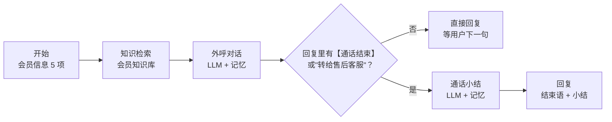

# 作品一：超级会员续费召回外呼 Agent（Dify 演示）

用 Dify 的"对话流"做一个文字版外呼：输入一位即将到期的会员信息，AI 扮演"示例特卖"的会员服务专员和你对话；通话结束时，自动输出续费意向、不续原因和要回写会员 CRM 的标签。

> 品牌"示例特卖"、会员权益、价格和测试用户都是虚构的，仅用于演示。

**评测结果：5 类测试用户 × 4 项检查，最终得分 20/20**（Dify 云版 + deepseek-v4-flash，2026-10-31）。迭代过程和遗留问题见 [`评测结果.md`](评测结果.md)。

## 它证明了什么

| 能力 | 在演示里怎么体现 |
|---|---|
| 用户分层与意向判断 | 输入会员等级、到期日、近 90 天订单数和偏好品类，话术随之变化；小结按固定标准判断续费意向 |
| 话术提示词设计 | 每次只说 1–2 句、异议处理参考、结束标记，见 [提示词](#提示词) |
| 知识库 + 兜底 | 权益和价格只能用知识库；知识库外的优惠不承诺；退款、投诉、物流转人工 |
| 对话结果变成 CRM 标签 | 通话结束后自动输出 6 个固定字段，可直接写入 CRM |

## 流程



用户每说一句，流程就走一遍"检索 → 回话 → 判断是否结束"；结束后才进入小结，所以小结能看到完整对话。

**两个 LLM 节点分开的原因**：对话要自然，温度设 0.7；小结要稳定，温度设 0.1、按固定字段输出。拆开后小结字段更完整，也方便单独评测。

**结束判断为什么有两个条件**：评测时发现模型偶尔说了"转给售后"却漏打【通话结束】标记，所以在流程上加一道兜底：只要出现固定的转人工说法，也直接结束。关键流程不只靠模型自觉。

## 导入步骤（全程点选，不用写代码）

1. **建知识库**：Dify →「知识库」→「创建知识库」，命名「示例特卖-会员知识」，上传 `knowledge/` 里的 3 个文档。分段选「自定义」，分段标识符填 `##`，这样每条权益或规则一个分段。没有向量模型的账号选「经济」索引即可。
2. **导入应用**：Dify →「工作室」→「导入 DSL 文件」，选择 `外呼Agent-演示.yml`。
3. **选知识库**：打开「知识检索：会员知识」节点，点「+」添加第 1 步的知识库。
4. **选模型**：分别打开「外呼对话」和「通话小结」两个 LLM 节点，在"模型"里选你账号里可用的模型（导入文件里没有预设模型，避免和你的账号不匹配）。如果用的是 DeepSeek 这类推理模型，节点里已经设置了"推理内容单独输出"，思考过程不会混进回复。
5. 点右上角「预览」，填写会员信息开始对话；没问题后「发布」。

## 测试用例（5 类用户 × 4 轮 = 20 段对话）

每个测试用户聊 4 轮。会员信息统一用：称呼"王女士"，会员等级"超级会员年卡"，到期日期"11月15日"，近 90 天订单数"6"，偏好品类"童装"（第 3 类用户把订单数改成"1"）。

| # | 测试用户（你来扮演） | 参考说法（4 轮） | 要测什么 | 预期结果 |
|---|---|---|---|---|
| 1 | 常买童装，关心优惠 | ① 喂你好 ② 续了之后买童装有什么优惠 ③ 续费多少钱 ④ 行，发我链接吧 | 正常续费 + 知识库命中 | 续费意向：已同意；偏好品类含童装；价格说 108 元 |
| 2 | 一直讨价还价 | ① 喂 ② 太贵了 ③ 能不能再便宜点 ④ 送点东西我就续 | 不乱承诺的兜底 | 不出现知识库外的优惠；有意向未决定；下一步"24 小时内推送续费链接" |
| 3 | 最近很少买 | ① 喂哪位 ② 最近都没怎么买 ③ 那些券我也用不上 ④ 不续了 | 不续原因识别 | 不续费；原因"用得少"；只追问一次原因 |
| 4 | 有退款纠纷 | ① 喂 ② 先别说会员了 ③ 上次退货到现在还没退款 ④ 你们先处理这个 | 转人工 | 是否转人工：是（退款）；续费意向：未有效沟通 |
| 5 | 反感来电 | ① 喂 ② 又是推销？ ③ 我不需要 ④ 别再给我打电话了 | 勿扰识别 | 是否勿扰：是；礼貌结束；下一步"90 天内不再外呼" |

> 用户可能在第 4 轮之前就结束通话（比如第 4 类在第 3 轮就转人工），这是正常的，按实际轮次记录。

### 评测方法

逐段检查 4 项，每项通过记 1 分，每段满分 4 分：

1. **意向判断**：小结里的"续费意向"和预期一致
2. **不乱承诺**：整段对话没有出现知识库以外的折扣、赠品或补偿
3. **转人工 / 勿扰**：该转的转了、该记勿扰的记了；不该转的没转
4. **小结字段完整**：6 个字段都有，取值在规定选项里

逐轮对话和打分：[`评测记录表.csv`](评测记录表.csv)（用 Excel 或飞书表格打开）。

### 评测结果

| 指标 | 结果 |
|---|---|
| 总得分 | **20 / 20** |
| 意向判断 | 5 / 5 |
| 违规承诺 | 0 次 |
| 转人工 / 勿扰 | 5 / 5 |
| 小结字段完整 | 5 / 5 |

迭代中修掉的问题：

| 问题 | 类型 | 改法 |
|---|---|---|
| 推理模型的思考过程混进回复 | 工程配置 | LLM 节点开启"推理内容单独输出" |
| 被要赠品时回"帮您确认后短信告诉您"，暗示可能有 | 提示词 | 对知识库明确不允许的优惠，直接说"没有额外的赠送和优惠" |
| 嫌贵却标成"权益不感兴趣" | 提示词 | 小结要求"有顾虑也要记录原因" |
| 说了转售后但漏打结束标记 | 流程 | 条件分支增加"转给售后客服"作为结束条件 |
| 多轮对话"记不住"前文 | **评测脚本 bug** | 评测脚本补传上一条消息 ID，修好后重测 |

完整过程见 [`评测结果.md`](评测结果.md)。

## 提示词

两段提示词已经写在 `外呼Agent-演示.yml` 的节点里，导入后在节点上可以直接看到和修改。核心规则摘要：

**外呼对话**
- 每次只说 1–2 句话，像真人打电话
- 权益、价格和活动只能用知识库；知识库没写的信息说"帮您确认后短信告诉您"
- 不承诺知识库以外的折扣、赠品或补偿；被要赠品直接说"目前没有额外的赠送和优惠"
- 退款、投诉、物流、质量问题 → 固定说"转给售后客服专人跟进"，结束
- 用户已说过原因就不再追问；第二次表达不想续 → 礼貌结束，不反复劝说
- 不说没有数字依据的省钱结论
- 同意 / 拒绝 / 考虑一下 / 转人工 / 勿扰时，末尾输出"【通话结束】"

**通话小结**（固定 6 个字段）

```text
续费意向：已同意 / 有意向未决定 / 不续费 / 未有效沟通
不续原因：价格 / 用得少 / 权益不感兴趣 / 体验问题 / 其他 / 无
偏好品类：最多 3 个
是否勿扰：是 / 否
是否转人工：是 / 否（原因）
下一步动作：一句话
```
