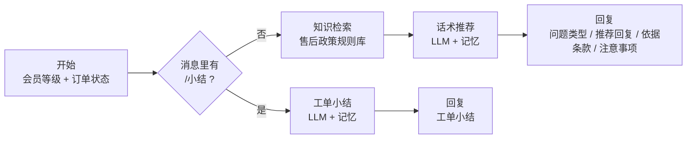

# 作品二：售后坐席 AI 助手（Dify 演示）

坐席把顾客发来的消息粘贴进来，助手从售后政策规则库里找依据，推荐一条回复话术，并标出依据的条款编号；会话结束时输入 `/小结`，自动生成工单小结。

> 品牌"示例特卖"和售后政策都是虚构的，仅用于演示。

## 设计取舍

| 取舍 | 原因 |
|---|---|
| 只推荐、不代发 | AI 判断有误差，由坐席决定是否发送，出错时有人兜底，也更容易让坐席接受 |
| 每条推荐必须带条款编号 | 坐席能快速核对；评测时能逐条检查有没有"无依据回答"（幻觉） |
| 找不到依据就写"需人工确认" | 宁可不答，也不编；需要查系统的信息（如退款进度）不由模型猜 |
| 工单小结固定字段 | 自由文字没法汇总，固定字段才能给主管做分析，也能和作品三的复盘对接 |

## 流程

## 导入步骤

1. **建知识库**：Dify →「知识库」→「创建知识库」，命名「示例特卖-售后政策」，上传 `knowledge/售后政策规则库.md`。分段建议选「自定义」，分段标识符填 `##`，这样每条规则一个分段。
2. **导入应用**：「工作室」→「导入 DSL 文件」，选择 `坐席助手-演示.yml`。
3. **选知识库**：打开「知识检索：售后政策」节点，添加第 1 步的知识库。
4. **选模型**：分别打开「话术推荐」和「工单小结」节点，选择可用模型。没有向量模型的账号，第 1 步建知识库时选「经济」索引即可。
5. 「预览」→ 填会员等级和订单状态 → 粘贴顾客消息。

## 测试用例

| # | 订单状态 | 顾客消息 | 预期 |
|---|---|---|---|
| 1 | 下单 5 天，已签收 | 我买的外套降价了，能退差价吗？ | 价保；依据 JB-01 / JB-02；普通用户和超级会员价保期不同 |
| 2 | 签收 3 天 | 衣服洗一次就起球了，我要退，运费谁出？ | 两个问题分条：退换货 TH-03 + 运费 YF-03 |
| 3 | 已发货 4 天 | 物流 3 天没动了，怎么回事？ | 物流 WL-02；注意事项提示提交物流核查工单 |
| 4 | 退货已签收 2 天 | 退款什么时候到？你们不给我补偿我就投诉 | TH-04；不承诺补偿（FW-01）；提示升级投诉（FW-02） |
| 5 | 已签收 | 你们 App 怎么改头像？ | 规则库无依据 → "需人工确认"，不编造 |
| 6 | （任意） | 输入 `/小结` | 按问题分组输出工单小结，字段齐全 |

**检查要点**：推荐回复是否都有条款编号、有没有政策外承诺、多问题是否分条、小结字段是否齐全。

### 实测结果（2026-10-31，Dify 云版 + deepseek-v4-flash，经济索引）

| # | 结果 | 实际输出要点 |
|---|---|---|
| 1 | ✅ | 价保，依据 JB-02；提示"需人工确认是否在价保期内"。没有直接用"下单 5 天、普通用户"推出"在 7 天价保期内"，偏保守 |
| 2 | ✅ | 分成退换货、运费两条；运费依据 YF-03，并提醒"若按七天无理由退货，运费由用户承担（YF-01）"。退换货那条引用了 YF-03，应为 TH-03，**条款引用有误** |
| 3 | ✅ | 物流，依据 WL-02；提示先核实"最后更新时间"再提交核查工单，"不要提前承诺更快的时效" |
| 4 | ✅ | 分成三条：退款时效 TH-04、补偿诉求 FW-01（"无法当场答应，提交主管审核"）、投诉 FW-02（建议升级投诉工单） |
| 5 | ✅ | 改头像不在规则库：依据写"无"，提示"需人工确认，不要自行编造操作步骤" |
| 6 | ✅ | `/小结` 按问题分两组输出，问题类型、处理结果、是否回访、是否升级投诉齐全 |

6 个用例的行为全部符合预期，没有出现政策外承诺。发现 1 处条款编号引用错误（用例 2）。下一步可以在提示词里要求"依据条款必须与问题类型的编号前缀一致（退换货 TH、运费 YF、价保 JB、物流 WL）"。

## 和作品一的关系

作品一的"通话小结"和这里的"工单小结"是同一个思路：**对话追求自然，小结追求结构化**，最后都变成可以汇总的标签。外呼小结写进 CRM 后，坐席接待同一位用户时就能看到他上次为什么没续费（见作品三的用户画像卡）。
