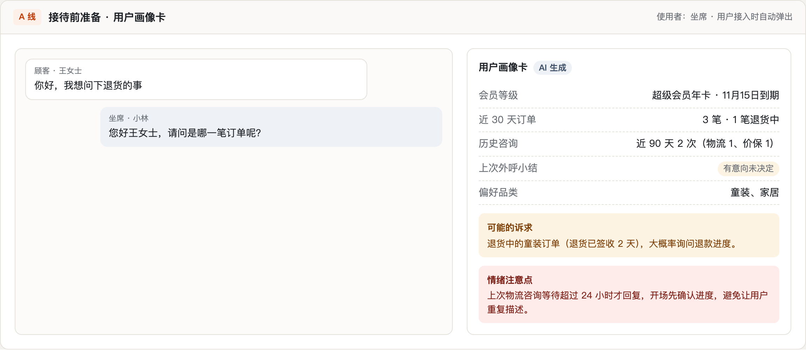
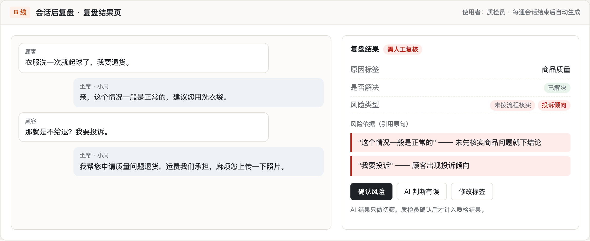
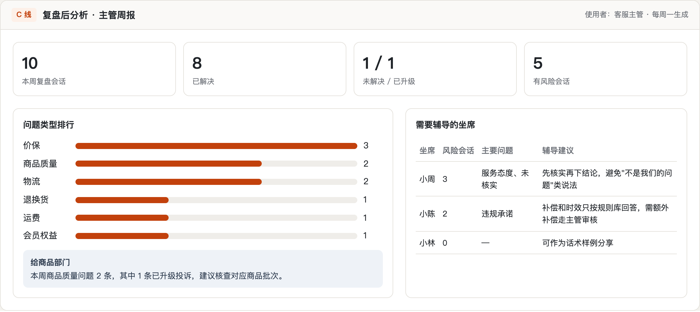

# 作品三：客服会话复盘与质检助手（Dify 演示 + 页面原型）

把一次课程作业里的"销售复盘助手"三条流程线换成客服场景：接待前准备、会话后复盘、复盘后分析。

> 全部会话、坐席和数据均为虚构，仅用于演示。

## 三条流程线

| 流程线 | 谁用、什么时候 | AI 做什么 | 产出 | 本仓库里的形式 |
|---|---|---|---|---|
| A 线：接待前准备 | 坐席，用户接入时 | 汇总会员等级、近期订单、历史咨询和外呼小结 | 用户画像卡：可能的诉求、情绪注意点 | 页面原型 |
| B 线：会话后复盘 | 系统，每通会话结束后 | 读完整会话，打原因标签，检查违规话术 | 结构化复盘：问题类型、是否解决、风险提示 | Dify 工作流 `会话复盘-演示.yml` + 页面原型 |
| C 线：复盘后分析 | 客服主管，每周 | 按坐席、问题类型汇总 | 周报：哪类问题最多、哪位坐席需要辅导 | Dify 工作流 `主管周报-演示.yml` + 页面原型 |

## 页面原型

**A 线 · 用户画像卡**

**B 线 · 复盘结果页**

**C 线 · 主管周报**

原型源文件：[`prototype/index.html`](prototype/index.html)，下载后用浏览器打开即可。

## 3 个设计取舍

1. **质检先做"全量初筛 + 人工复核"，不直接让 AI 打分**。AI 判断有误差，如果直接影响坐席绩效会引发抵触；先用来缩小人工复核范围，信任建立后再扩大。复盘结果页上的"AI 判断有误"按钮，就是收集误判数据、持续改进的入口。
2. **原因标签固定，风险提示必须引用原句**。自由文字没法汇总；固定标签才能给主管和商品、物流部门做分析。引用原句让质检员一眼能核对，也能减少模型凭空判断。
3. **三个作品连成闭环**。外呼小结（作品一）写进会员 CRM，坐席接入时成为 A 线画像卡的输入；会话结束后的工单小结（作品二）和复盘（B 线）又回写 CRM，形成"触达 → 服务 → 复盘"的闭环。

## 导入步骤

1. Dify →「工作室」→「导入 DSL 文件」，分别导入 `会话复盘-演示.yml` 和 `主管周报-演示.yml`（两个都是"工作流"类型，不需要知识库）。
2. 打开各自的 LLM 节点，选择可用的模型。
3. 「运行」：
   - 会话复盘：把 [`示例会话.md`](示例会话.md) 里任意一段会话粘贴到「完整会话记录」，坐席名称填对应坐席；
   - 主管周报：把 `示例会话.md` 末尾的"用于主管周报的输入"整段粘贴进去。

## 测试与评测

[`示例会话.md`](示例会话.md) 里有 6 段会话，每段写了预期结果，覆盖：正常会话、未核实就下结论、违规承诺时效、服务态度、照念政策原文（不应误报）、违规承诺补偿。

检查要点：

| 维度 | 检查什么 |
|---|---|
| 准确性 | 原因标签、是否解决和预期一致 |
| 召回 | 预期里的风险都被标出来了 |
| 误报 | 会话 5（照念政策原文）没有被标成服务态度问题 |
| 可解释 | 每条风险提示都引用了会话原句 |
| 周报 | 条数是数出来的（10 条、已解决 8 条），没有编造坐席或问题 |
