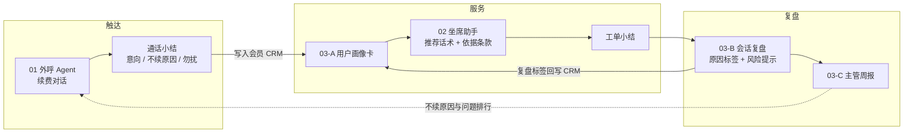

# 会员 CRM 与客服 AI Agent 作品集（Dify 演示）

三个用 Dify 搭建的 AI 演示，覆盖会员运营和客服的一条完整链路：**触达 → 服务 → 复盘**。

> **声明**：这是个人复刻的练习作品。品牌"示例特卖"、会员权益、售后政策、会话和全部数据都是虚构的，不对应任何真实公司或系统。

## 三个作品

| 作品 | 解决什么问题 | Dify 类型 | 内容 | 实测结果 |
|---|---|---|---|---|
| [01 续费召回外呼 Agent](01-renewal-call-agent/) | 人工外呼覆盖不了大部分到期会员，打完电话也不知道用户为什么不续 | 对话流 | DSL、3 份知识库、测试用例、评测记录与迭代过程 | 5 类用户 × 4 项检查，20/20 |
| [02 售后坐席 AI 助手](02-agent-assist/) | 政策多、更新快，新人坐席查规则慢、口径不一，工单小结手写费时 | 对话流 | DSL、售后政策规则库（20 条带编号）、测试用例 | 6/6 符合预期，1 处条款引用有误 |
| [03 会话复盘与质检助手](03-review-qa/) | 质检只能人工抽检一小部分，复盘结论是自由文字没法汇总 | 工作流 ×2 | 复盘 DSL、周报 DSL、6 段示例会话、3 个页面原型 | 风险召回 6/6，多标 2 处；周报计数全对 |

> 实测环境：Dify 云版（Sandbox）、deepseek-v4-flash、经济索引知识库，2026-10-31。

## 闭环设计



三个作品用的是同一个思路：**对话追求自然，小结追求结构化**。所有 AI 输出最后都落成固定字段的标签，才能被汇总、被下一个环节使用。

## 每个作品都做了的三件事

1. **知识库 + 兜底**：权益、价格、政策只能来自知识库；知识库外的优惠和补偿一律不承诺；退款、投诉等交给人工。
2. **结构化输出**：通话小结、工单小结、复盘结果都是固定字段、固定选项。
3. **可评测**：每个作品都附带测试用例和预期结果，能算出通过率，知道错在哪一类、该改提示词还是知识库。全部用例和自动评测脚本集中在 [`评测集/`](评测集/)。

## 怎么在 Dify 里跑起来（不用写代码）

1. 注册或登录 [Dify](https://cloud.dify.ai)。
2. 作品 01、02 需要先建知识库：「知识库」→「创建知识库」→ 上传对应文件夹 `knowledge/` 里的文档。
3. 「工作室」→「导入 DSL 文件」→ 选择对应的 `.yml` 文件。
4. 打开流程里的「知识检索」节点添加知识库；打开每个 LLM 节点选择模型（导入文件没有预设模型，选你账号里能用的即可）。
5. 点「预览」或「运行」，按 [`评测集/`](评测集/) 里的用例手动测试；也可以用里面的脚本一次跑完全部用例并自动打分。

## 目录

```text
.
├── 01-renewal-call-agent/      续费召回外呼 Agent
│   ├── 外呼Agent-演示.yml
│   ├── knowledge/              会员权益、续费价格与活动、转人工与勿扰规则
│   ├── 评测记录表.csv           实测的逐轮对话和打分
│   ├── 评测结果.md              迭代过程和遗留问题
│   └── README.md
├── 02-agent-assist/            售后坐席 AI 助手
│   ├── 坐席助手-演示.yml
│   ├── knowledge/              售后政策规则库
│   └── README.md
├── 03-review-qa/               会话复盘与质检助手
│   ├── 会话复盘-演示.yml
│   ├── 主管周报-演示.yml
│   ├── 示例会话.md
│   ├── prototype/              页面原型（HTML + 截图）
│   └── README.md
└── 评测集/                     全部测试用例 + 自动评测脚本
    ├── 外呼Agent-测试用例.csv
    ├── 坐席助手-测试用例.csv
    ├── 会话复盘-测试用例.csv
    ├── 主管周报-测试用例.csv
    ├── run_eval.js
    └── README.md
```
